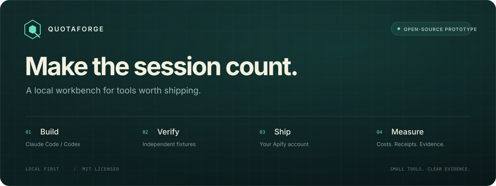
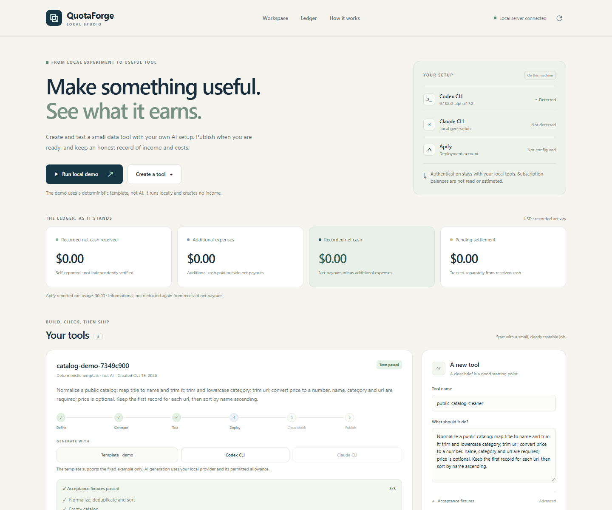
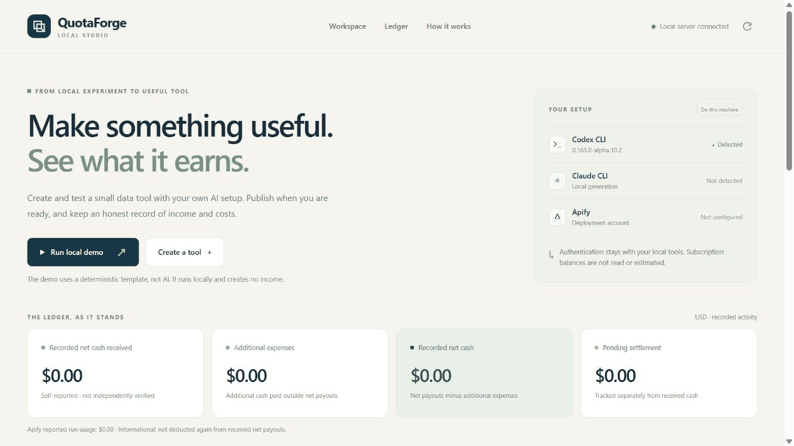

  

  <strong>Give your next AI session something worth shipping.</strong> 
  Turn a small data-tool idea into a tested Apify Actor, then track what actually happens.

  <a href="#quickstart">Quickstart</a> ·
  <a href="#the-workflow">Workflow</a> ·
  <a href="#bring-your-own-tools">Connect your tools</a> ·
  <a href="docs/BUSINESS_AND_RELEASE_PLAN.md">Business &amp; releases</a> ·
  <a href="docs/PUBLIC_PREVIEW.md">Public preview</a> ·
  <a href="docs/ARCHITECTURE.md">Architecture</a> ·
  <a href="docs/VALIDATION.md">Validation</a>

---

**QuotaForge is a local, open-source workbench for shipping small data tools.** Use your own Claude Code or Codex installation to generate a bounded specification. Check it against independent fixtures. Package it for your own Apify account. Keep an evidence-linked ledger of costs and receipts.

The prototype focuses on one useful job: **normalizing JSON records into consistent, reusable data.** Generated specifications run on a trusted, allowlisted engine; they are not arbitrary model-written programs.

<table>
<tr>
<td width="33%"><strong>Your tools</strong> Official Claude Code or Codex CLI. Your login stays with its provider.</td>
<td width="33%"><strong>Your storefront</strong> Deploy to your own Apify account. Review before making an Actor public.</td>
<td width="33%"><strong>Your evidence</strong> Track pending amounts, recorded receipts, and costs separately.</td>
</tr>
</table>

  

  Earlier local dashboard snapshot · Deterministic demo · 3 acceptance fixtures passed · $0 recorded receipts · Apify was unconfigured at capture

**Verification snapshot · October 15, 2026:** 55 automated tests passed on Windows. Live Codex generation passed 3 independent fixtures. A real Apify build, cloud fixture check, and public publication passed; the default build is pinned to the checked version. Claude live verification remains pending. [Read the evidence and its scope →](docs/VALIDATION.md)

**Live example:** [Public Catalog Normalizer on Apify](https://apify.com/victor_zhu/public-catalog-normalizer). This example is public and currently has no creator fee configured; Apify platform usage charges may apply.

> **Prototype, not a profit promise.** The local demo uses deterministic fixtures, with no model calls, cloud deployment, or fabricated income. A passing test does not establish demand. A ledger entry does not independently verify payment.

Latest local preview checks: [October 20, 2026](docs/VALIDATION.md). All **57 tests passed**, including two local-date accounting regressions. A clean demo and tests from an extracted source archive passed on Windows with Node.js 24.19. The earlier [operational checkpoint](docs/updates/2026-10-20.md) records the public Actor and pinned build check. Creator monetization and customer demand remain unvalidated.

## Public preview

The `v0.1.0` source preview is prepared locally. Follow the [public-preview runbook](docs/PUBLIC_PREVIEW.md) for clean-copy checks, source packaging and GitHub publication, and review the [release-note draft](docs/releases/v0.1.0.md). GitHub publication and the configured Windows/Linux × Node 22/24 CI matrix have not run yet.

~~~sh
node --run demo:check
node --run preview:check
node --run preview:pack
~~~

The checks use separate temporary state. Packaging creates an allowlisted source ZIP, a per-file SHA-256 manifest and a whole-archive checksum under the ignored `release/` directory. It excludes personal environment files, project state and generated Actor exports.

This walkthrough uses four actual dashboard captures from a fresh local session; playback timing is adjusted for reading. It shows deterministic generation, verification and source inspection, with no model call, cloud deployment or receipt. The full live generation-to-publication recording remains a follow-up.

## Quickstart

Requirements: **Node.js 22 or later**. The local application uses Node built-ins and requires no npm dependency installation.

Download this repository, open a terminal in its directory, and run:

~~~sh
node --run demo
node --run start
~~~

Open **http://127.0.0.1:4317**.

The demo creates an example project and exercises the local verification and packaging workflow. It does not require an AI subscription or an Apify account.

~~~sh
node --run test
node src/cli.mjs doctor
~~~

The dashboard and CLI share the same project state. Local state is stored in the ignored `.quotaforge/` directory by default.

## The workflow

~~~mermaid
flowchart LR
    A["Idea + independent fixtures"] --> B["Claude Code / Codex"]
    B --> C["Bounded ToolSpec"]
    C --> D["Validate + test"]
    D --> E["Package Actor"]
    E --> F["Private Apify build"]
    F --> G["Cloud fixture check"]
    G --> H["Review + publish"]
    H --> I["Costs + receipt ledger"]
~~~

| Step | What QuotaForge does | What remains your decision |
| :--- | :--- | :--- |
| **Generate** | Asks an installed provider CLI for a declarative normalization specification | Select a real need and an authorized data source |
| **Verify** | Checks the allowed specification and compares output with independent fixtures | Review whether those fixtures capture the intended behavior |
| **Package** | Builds an Actor using the trusted runtime | Review the product and its operational limits |
| **Deploy** | Uploads to your Apify account and checks the build | Approve the cloud action and its possible costs |
| **Cloud check** | Runs one acceptance fixture against the exact private cloud build and checks the dataset | Approve the run and its possible costs |
| **Publish** | Requires a passing cloud check before public publication | Confirm publication; configure pricing and payout details in Apify Console |
| **Measure** | Imports run costs and records evidence-linked ledger entries | Reconcile receipts with your payment records |

Independent fixtures are part of the product contract. The model does not get to rewrite the expected answers to make its output pass.

## Bring your own tools

### Claude Code or Codex

Install the official CLI you intend to use and sign in through that CLI's own authentication flow:

- [Claude Code setup](https://code.claude.com/docs/en/setup) · [authentication](https://code.claude.com/docs/en/authentication)
- [Codex CLI](https://developers.openai.com/codex/cli) · [authentication](https://developers.openai.com/codex/auth)

QuotaForge invokes the installed executable. It does not collect provider passwords or offer a shared subscription gateway. Your provider's current product terms, usage limits, and supported authentication methods still apply.

Start a project from the example brief and independent fixtures, then use its returned ID:

~~~sh
node src/cli.mjs doctor
node src/cli.mjs create --file examples/catalog.json
node src/cli.mjs list
node src/cli.mjs generate <project-id> --provider codex
node src/cli.mjs test <project-id>
node src/cli.mjs artifact <project-id> --out ./exports/my-actor
~~~

Use `--provider claude` instead to generate with Claude Code. Export to a new directory; the artifact command refuses to overwrite existing files. Edit a copy of `examples/catalog.json` to supply your own brief and independent fixtures.

The selected CLI needs to be available on `PATH`. Optional `QF_CODEX_BIN` and `QF_CLAUDE_BIN` settings select executable paths. On Windows, configure the native `.exe` when needed; shell wrappers such as `.cmd`, `.bat`, and `.ps1` are not supported. Treat executable configuration as trusted local configuration.

The adapters do not read remaining subscription quota. `doctor` detects installed CLI versions; it does not prove login or account access. See [integration details](docs/INTEGRATIONS.md) for execution and authentication boundaries.

Use a recent official CLI. Codex ignores user configuration and disables shell, app, plugin, delegation, browser, computer, hook, and web-search access for structured generation. Claude runs in safe mode with tools disabled. Each generation uses a fresh empty temporary working directory. Official authentication is retained; these controls are not an operating-system privacy guarantee. The [integration details](docs/INTEGRATIONS.md) list the required flags.

**Provider adapters and live provider verification are different things.** See [the validation record](docs/VALIDATION.md) before assuming a particular account, operating system, or CLI version has been exercised.

### Apify

Use your own Apify account and provide `APIFY_TOKEN` to the backend process. The CLI automatically loads a local `.env` file from the current working directory; existing shell environment values take precedence. You can copy the example settings from `.env.example` into your own `.env` and add your token:

~~~dotenv
APIFY_TOKEN=your-token
~~~

The local `.env` is ignored by Git. It is still a plaintext credential file: keep it on your machine. Do not put tokens into frontend code, screenshots, issue reports, or committed files. Alternatively, set the token only for the shell that launches the app.

PowerShell:

~~~powershell
$env:APIFY_TOKEN = "your-token"
node --run start
~~~

macOS / Linux:

~~~sh
export APIFY_TOKEN="your-token"
node --run start
~~~

The CLI path is explicit:

~~~sh
node src/cli.mjs deploy <project-id> --confirm
node src/cli.mjs sync <project-id>
node src/cli.mjs smoke <project-id> --confirm
node src/cli.mjs publish <project-id> --confirm
~~~

Deployment and publication are separate operations. Publication checks the Actor/build relationship, requires a passing cloud fixture check, and pins the checked cloud build number. Use `sync` to refresh a pending build result. The `smoke` command runs one nonempty acceptance fixture against the private Actor and compares its dataset with the expected output. This is a narrow integration check, not exhaustive production validation. Cloud actions can incur charges. Actor Store listing, pricing, account verification, and payout setup also have platform requirements.

The Actor includes the pay-per-event event name **`record-normalized`**. An event name alone does not configure a paid product. Review and configure pricing in Apify Console using [Apify's monetization documentation](https://docs.apify.com/actors/publishing/monetize).

## Money, with the labels left on

QuotaForge distinguishes **pending revenue**, **recorded payouts**, and **expenses**. The prototype's revenue ledger is entered by the operator and linked to an evidence reference; it is not a bank integration or an audit.

~~~sh
node src/cli.mjs ledger add --project <project-id> --kind payout --amount 12.50 --reference "settlement-reference" --date 2026-10-15
~~~

The example is command syntax, **not a sample earning claim**.

- A **payout** is net cash actually received.
- An **expense** is an additional cash payment. Exclude deductions already reflected in a net payout.
- A **pending** entry has not been received. Add `--settles <pending-reference>` to a payout to identify the pending entry it settles.
- **Imported run usage** is informational platform cost, never income. It is not automatically subtracted again from net cash.

Synced run usage covers runs visible to the owner's account. It is not a complete view of every customer's usage or all build and operating costs. A useful comparison also records refunds, external API charges, subscription cost where relevant, and operator time.

This prototype does not claim that a subscription is cheaper than an API.

## Configuration

| Setting | Purpose |
| :--- | :--- |
| `APIFY_TOKEN` | Backend credential for your Apify account |
| `QF_CODEX_BIN` | Optional path to the installed Codex executable |
| `QF_CLAUDE_BIN` | Optional path to the installed Claude Code executable |
| `QF_DATA_DIR` | Optional local state directory; defaults to `.quotaforge/` |

The server binds to loopback at `127.0.0.1`. This is a personal local application, not a hosted multi-tenant service.

## What this prototype is testing

**Can a person turn a narrow idea into a tested, deployable tool with less repetitive work—and record the outcome honestly?**

The first release is deliberately bounded:

- One tool family: declarative JSON record normalization.
- Two local generation adapters: Claude Code and Codex.
- One deployment destination: Apify.
- Independent fixtures and a trusted runtime.
- A local dashboard, CLI, run-cost sync, and manual USD ledger.

Automatic customer acquisition, autonomous pricing, subscription resale, general-purpose generated-code execution, guaranteed revenue, and automatic detection of remaining subscription quota are outside this prototype.

## Roadmap

- **Now:** verified Codex generation, a successful Apify build and cloud fixture check, and a publicly published example pinned to the checked build.
- **Next:** verify Claude Code live and test onboarding with fresh accounts.
- **Then:** run a small external pilot with distinct tools, including zero-income outcomes.
- **Only with evidence:** expand tool families and maintenance automation.

No roadmap milestone implies a financial return.

## Build with us

Useful contributions make a concrete workflow more reliable: a reproducible provider issue, a missing fixture, a clearer onboarding step, or an independently tested integration.

Read [CONTRIBUTING.md](CONTRIBUTING.md), [SECURITY.md](SECURITY.md), and the [architecture](docs/ARCHITECTURE.md). Keep public-facing material in English.

Released under the [MIT License](LICENSE). Claude, Codex, and Apify are names of their respective providers. QuotaForge is an independent project and does not imply their endorsement.
